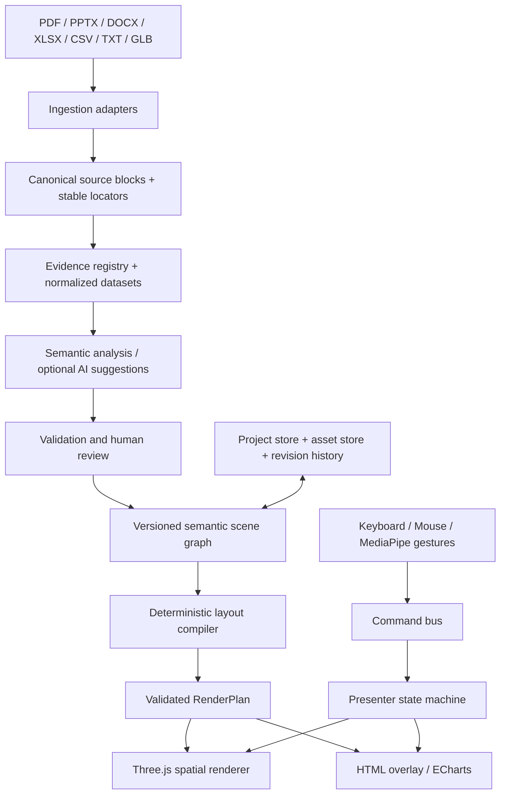

# Iron Man Spatial Presentation System — Architecture Decision Record v3

**Status:** target architecture, not a claim of implementation or deployment.
**Product:** desktop-first cloud presentation authoring and spatial presenting. No microphone or voice. Browser display is simulated spatial computing, not room-anchored AR.

## 1. Non-negotiable engineering rules
1. **Evidence before visualization.** Every extracted claim, metric and relationship carries a locator back to the original source; unverified or user-edited facts are marked as such.
2. **Semantic content independent of geometry.** A scene declares what it means, not where every pixel or mesh must go. Layout engine owns geometry.
3. **Renderer is pure consumer.** It receives a validated RenderPlan; it never parses documents, guesses missing data, or changes facts.
4. **Inputs are interchangeable.** Gesture, mouse, keyboard and touch emit the same semantic commands; the editor never depends on a webcam.
5. **Feature modules are replaceable.** Parsing, AI assistance, layout, rendering, gestures and persistence have separate APIs and versioned contracts.
6. **Progressive enhancement.** Dense tables and labels use accessible HTML overlays; 3D adds depth only where it improves understanding.
7. **Privacy by design.** Document parsing and camera tracking can remain local; uploading and AI processing require explicit consent and disclosed providers.
8. **No claims of physical accuracy** for models synthesized from text; physical 3D geometry requires a real asset or an explicitly labeled illustrative model.

## 2. System boundaries and data flow

No component may skip the validation stage and feed raw LLM text directly into geometry. Every stage emits warnings, confidence/quality status and source references.

## 3. Canonical contracts

**SourceDocument:** id, name, MIME/type, content hash, extraction version, blocks[]. Each block has stable id, kind, text/data and locator (page/slide/sheet/cell/paragraph/offset). Preserve original file separately.

**EvidenceRecord:** id, sourceId, blockId, exact quote/value, locator, status (extracted / verified / derived / user-edited / unverified), derivation expression if applicable.

**SemanticScene:** id, title, type, nodes[], edges[], source references, presenter notes, layout constraints. A process edge requires explicit evidence and direction; a chart must carry units, series, categories, missingness, transformations and source IDs.

**RenderPlan:** scene id, renderer type, nodes with normalized data, geometry instructions, camera preset, interaction targets, accessibility labels, overlay anchors, performance budget. Geometry is compiled deterministically from the semantic scene.

**Command:** {type, targetId?, payload?, inputSource, timestamp}. Examples: SELECT, NEXT_SCENE, PREVIOUS_SCENE, ZOOM, ROTATE, FOCUS, RESET, TOGGLE_DETAILS. No direct gesture-to-Three.js mutations.

**Project:** schemaVersion, sources, evidence, datasets, scenes, assets, revisionId, createdAt, updatedAt. Versioned migrations required; imported project files validated before use.

Initial executable contracts are in `architecture/contracts.js`. These are intentionally framework-independent. They do not yet replace the existing v1 project format.

## 4. Recommended maintained open-source dependencies

| Layer | Choice | Why / boundary |
|---|---|---|
| Application | React + TypeScript + Vite | Typed modular UI and reliable bundling; replace current single-file DOM controller incrementally |
| State / orchestration | Zustand for editor state; XState for presenter/gesture finite-state machines | Separate editable state from explicit transitions |
| Contracts | Zod | Runtime validation of imported/AI-produced scene data; schema version migrations |
| 3D | Three.js + React Three Fiber + Drei | Reuse Three.js engine and maintained React abstractions; single canvas and resource lifecycle |
| Models | Three.js GLTFLoader; optional DRACOLoader/KTX2Loader | GLB/glTF 2.0 standard, preserve mesh hierarchy and metadata |
| Layout | ELK.js for directed graphs; d3-force-3d only for genuine network graphs | Graph edges must originate in evidence, never inferred for decoration |
| Charts | Apache ECharts for exact, dense analytical charts; custom Three.js chart only when beneficial | Accessible labels and tooltips; data transforms are explicit |
| PDFs | PDF.js | Text extraction with page locations; detect scans, do not pretend OCR succeeded |
| PPTX | JSZip + structured Open XML extraction | Slide/text/table grouping; document layout needs a dedicated adapter |
| DOCX | Mammoth + Open XML structure for provenance | Semantic text; do not claim full page fidelity |
| Spreadsheets | SheetJS or ExcelJS (check license, format coverage, version) | Sheet and cell coordinates; preserve types, formulas, number formats |
| Gesture | MediaPipe Tasks Vision | 21 landmarks, confidence, calibration; isolate synchronous inference in worker when browser support allows |
| Testing | Vitest + Playwright | Contract tests, visual regression, gesture command simulations |
| Backend | Postgres + object storage, server-side authorization | Project versioning, private asset access, optional collaboration |

**Selection policy:** lock compatible versions; verify package licenses, security advisories, browser support and maintenance before adoption. Do not copy random snippets from GitHub into production. Prefer official packages, documented APIs, reproducible installs, software-bill-of-materials and license inventory.

## 5. Scene families and rendering rules

- **Concept:** clear cards with readable HTML labels, optional depth; no fabricated connecting lines.
- **Comparison:** aligned categories and consistent scales; 2D table fallback.
- **Timeline:** dates and order must be explicit in source; otherwise use a list.
- **Process:** directed connectors only when source explicitly states a sequence or dependency.
- **Network:** evidence-backed nodes and edges; edge labels and provenance on selection.
- **Chart:** typed values, units, locale, nulls and transformations; prefer ECharts when many values or text labels.
- **Table:** responsive DOM grid, sticky headers, original values; never force 50 cells into unreadable 3D.
- **Model:** import verified glTF/GLB; inspect hierarchy, orbit, isolate, explode only if actual component structure supports it.
- **Media:** source images/videos as surfaces with attribution, no false physical dimensions.

A scene registry maps scene type to schema, compiler, renderer, editor controls, fallback and export adapter. New scene types register there; no giant `if/else` in the root app.

## 6. Spatial composition

Presenter-first desktop view: **left/center stage** holds one focal object, **right presenter space** is kept clear, **top context bar** shows title/source state, **bottom compact navigation**. Inspector is an editor-only panel and disappears in live presentation.

Camera framing must be derived from scene bounding boxes, viewport dimensions and safe areas. Text readability has priority over perspective. Prevent collisions by constraint-based layout and adaptive detail; large scenes switch to clustering, paging or table view. Depth is semantic, not decoration.

Use one shared scene runtime; presenter/editor can have distinct views without duplicating document interpretation. Cache geometries/materials, dispose assets on scene change, cap pixel ratio, handle WebGL context loss and fallback to DOM where appropriate.

## 7. Input architecture

MediaPipe inference -> landmark filter -> gesture classifier -> hysteresis/dwell -> semantic command -> presenter state machine -> scene runtime.

Hand tracking never directly mutates mesh transforms. Distinguish SELECT vs ROTATE vs NAVIGATE, require calibration, avoid accidental pinch triggers, recover after tracking loss. Keyboard/mouse command equivalents are mandatory. Camera access opt-in, never record/upload video by default. No voice features.

## 8. AI / content intelligence

AI is an optional *proposal generator*, not a trusted compiler. Prompt with canonical source blocks and identifiers; demand schema-constrained output; reject missing evidence IDs, invented units, unsupported edges, and unsupported 3D asset claims. Store proposals and user approval separately. Deterministic extraction/validation works without AI or network.

For transformations such as percentages or growth, record formula, inputs, unit conversions and rounding policy. Do not merge USD and EUR without an explicit conversion dataset/date.

## 9. Repository migration without breaking the alpha

1. Freeze the existing browser alpha as a reference; do not delete its working entrypoint.
2. Add `architecture/` contracts and fixtures; establish v1 -> v3 import adapter.
3. Move ingestion to `src/ingest/adapters` returning SourceDocument, not a flattened string.
4. Add `src/domain` for source/evidence/project/scene types, schema validation and migrations.
5. Add `src/compiler` for semantic-to-render plans and scene registry.
6. Add `src/runtime` for Three.js resources, camera, layout, overlays and model loading.
7. Add `src/input` for gesture, pointer, keyboard and command bus.
8. Add `src/features` for dashboard, studio, editor and presenter.
9. Add `src/services` for persistence, asset storage and optional AI.
10. Switch entrypoint only after adapters preserve existing projects and presentation behavior.

## 10. Architectural acceptance gates (not deployment tasks)

- Each scene type can be authored, validated, rendered and exported without modifying core editor.
- Every chart value traces to a source cell or an explicit recorded derivation.
- Invalid evidence edges, units, model assets and project versions fail validation.
- A 3D model uses imported GLB/glTF geometry; never substitutes arbitrary primitives as factual geometry.
- Gesture and keyboard issue identical commands and share the same presenter state machine.
- An imported older project migrates or produces a recoverable validation report.
- Dense content has an accessible readable fallback; camera fit and presenter-safe regions are deterministic.
- No parser or rendering library is dynamically fetched from an unreviewed URL at runtime in the target architecture.
- The application is usable offline for already cached/local projects, subject to installed assets and browser capabilities.

## 11. Primary documentation / standards
- Three.js WebGLRenderer: https://threejs.org/docs/pages/WebGLRenderer
- Three.js GLTFLoader: https://threejs.org/docs/pages/GLTFLoader
- Khronos glTF 2.0 specification: https://registry.khronos.org/glTF/
- Google MediaPipe Hand Landmarker web: https://ai.google.dev/edge/mediapipe/solutions/vision/hand_landmarker/web_js
- Apache ECharts dataset transformations: https://echarts.apache.org/handbook/en/concepts/data-transform/

**Architectural decision:** modular monolith first. Separate deployable microservices are not justified until scaling requirements are proven. Cloud services should be accessed behind interfaces, not imported into scene logic.
